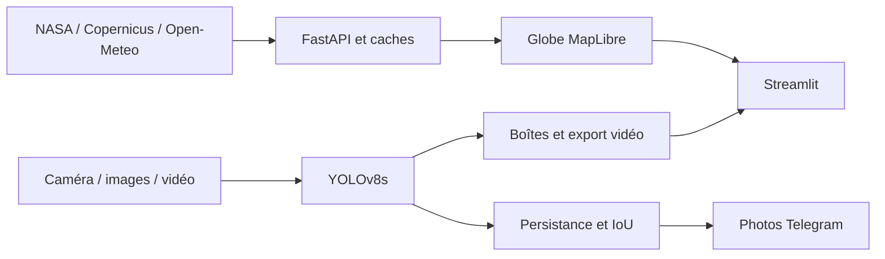

[English](README.md)

# MedFire Watch

Observation satellite et météo, avec détection locale du feu et de la fumée sur caméra, images et vidéos.

[![CI][ci-badge]][ci]

[ci-badge]: https://github.com/jasser-z/medfire-watch/actions/workflows/ci.yml/badge.svg
[ci]: https://github.com/jasser-z/medfire-watch/actions/workflows/ci.yml

[](LICENSE)

| Prédiction en direct | Du globe à la ville en 3D |
| --- | --- |
|  |  |

## Résultats clés

| Mesure | Résultat |
| --- | --- |
| mAP50, test officiel D-Fire | **0,747**, 4 306 images |
| Précision / rappel | **0,740 / 0,681** |
| Analyse vidéo GPU, lots de 8 | **205,81 images/s**, NVIDIA RTX 4060 |
| Export annoté 1080p60 | **44,209 images/s**, 1 645 images en entrée et en sortie |

Sources : [métriques](docs/results/detection_final_metrics.json),
[conditions de mesure](docs/VIDEO_BENCHMARK.md), [fiche modèle](docs/MODEL_CARD.md).

## Fonctionnalités

- Explorer un globe avec observations NASA, danger météo officiel et prévisions locales.
- Détecter le feu et la fumée par caméra et mettre en file des photos Telegram après persistance.
- Analyser des images et lire les vidéos avec boîtes alignées, chronologie et priorité à la recherche temporelle.
- Consulter les tentatives d'envoi et télécharger une vidéo annotée à sa résolution source.

## Interface

| Danger incendie | Inspection d'image |
| --- | --- |
|  |  |
|  |  |
|  |  |
|  | **Photo reçue** · 27 oct. 2026 · Fumée 73 %. |

Les points satellite sont des observations NASA réelles. Le GIF du globe à la ville présente les bâtiments 3D.

La présentation des alertes inclut la photo Telegram fournie par l'auteur, datée du 27 octobre 2026.

[Sources des médias](docs/media/CREDITS.md)

Cartes : EOxCloudless par [EOX](https://eox.at/) (données Copernicus Sentinel 2025 modifiées),
OpenFreeMap, © OpenMapTiles, © contributeurs OpenStreetMap. [Conditions](THIRD_PARTY_NOTICES.md).

## Démarrage

Python 3.11 est requis. Sous Windows PowerShell :

```powershell
python -m venv .venv
.venv\Scripts\python.exe -m pip install -r requirements.txt
.venv\Scripts\python.exe scripts/run_app.py
```

Sous Linux/macOS :

```sh
python3.11 -m venv .venv
.venv/bin/python -m pip install -r requirements.txt
.venv/bin/python scripts/run_app.py
```

Ouvrir [localhost:8501](http://127.0.0.1:8501). Copier `.env.example` vers `.env` et y placer
ses propres identifiants FIRMS et Telegram. Le détecteur utilise le checkpoint fourni.
Le [guide](docs/GUIDE.md) détaille l'installation et le dépannage.

## Fonctionnement



[Architecture](docs/ARCHITECTURE.md) · [Entraînement](docs/TRAINING.md)

## Évaluation


## Limites

- Les observations satellite peuvent être tardives, masquées ou industrielles ; elles ne confirment pas un incendie.
- Le danger météo n'est pas une probabilité d'ignition ; le zoom n'affine pas la prévision et la mosaïque EOX est datée.
- Le détecteur peut manquer un feu ou déclencher à tort ; le taux d'alertes par caméra-heure reste à mesurer.
- Matériel, navigateur et réseau influencent latence et envoi ; l'export à fréquence variable est incomplet.
- L'application de recherche aide l'investigation humaine et exige une vérification par les services compétents.

[Limites détaillées](docs/LIMITATIONS.md) · [Protocole du modèle](docs/MODEL_CARD.md)

## Feuille de route

Surveillance multi-caméra sans navigateur, évaluation indépendante des fausses alertes et du délai,
authentification API optionnelle et sécurisation du déploiement.

## Technologies et structure

Python 3.11, FastAPI, Streamlit, YOLOv8, PyTorch, OpenCV, FFmpeg, MapLibre, pytest et Node.js.
`api/` et `dashboard/` portent l'interface ; `medfire_watch/` et `alerts/` les services ;
`models/` le checkpoint ; `scripts/` et `configs/` les outils ; `tests/` et `docs/` les vérifications et résultats.

## Crédits et licences

Code sous [AGPL-3.0](LICENSE), copyright Jasser Zormati. Les droits des fournisseurs et
des images sources s'appliquent séparément. EOX gratuit et l'API gratuite Open-Meteo
comportent des conditions non commerciales. Les [notices](THIRD_PARTY_NOTICES.md)
décrivent les attributions, le partage à l'identique et les permissions non vérifiées.

## Auteur

Jasser Zormati · [LinkedIn](https://linkedin.com/in/jasser-zormati) · [GitHub](https://github.com/jasser-z)
