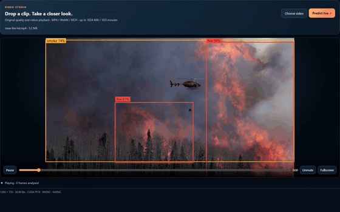
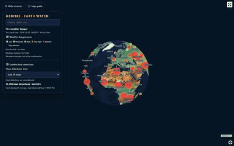
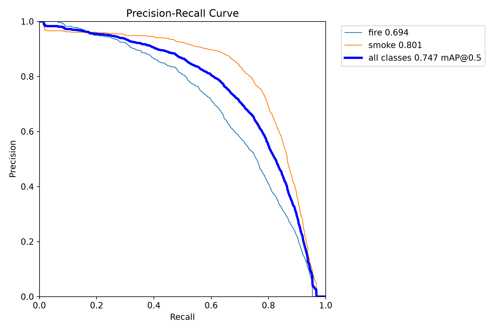
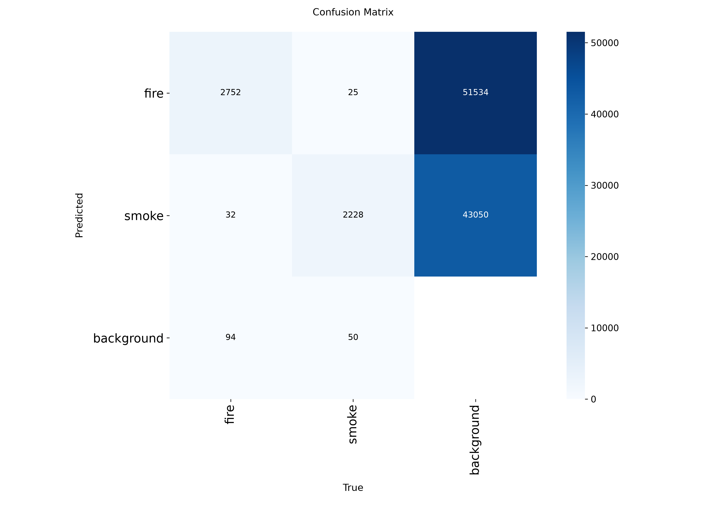
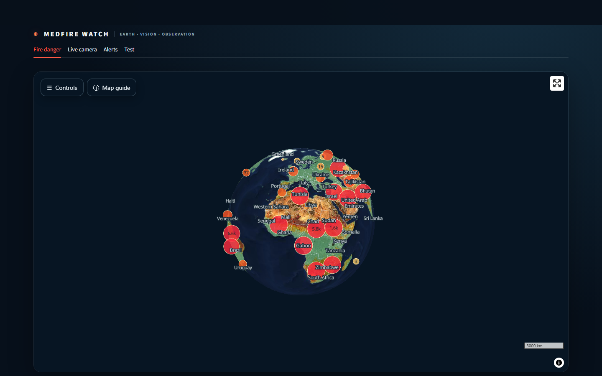
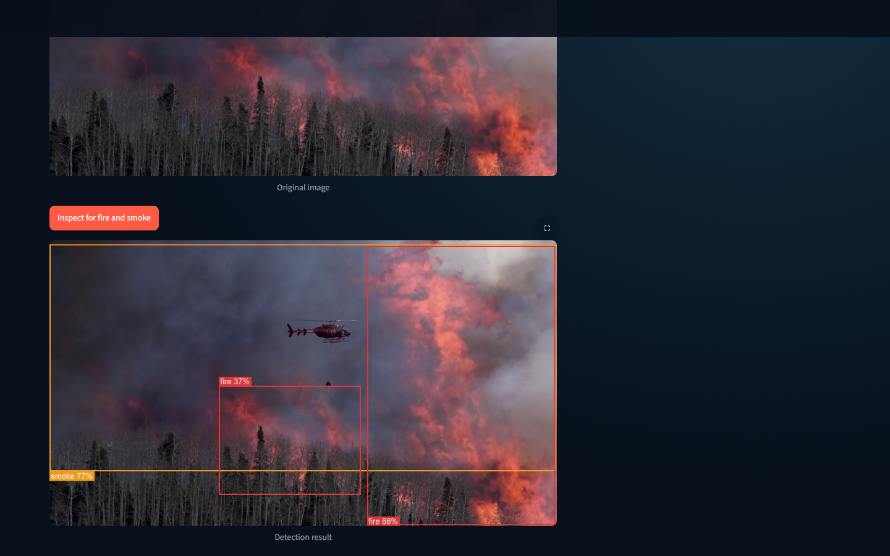
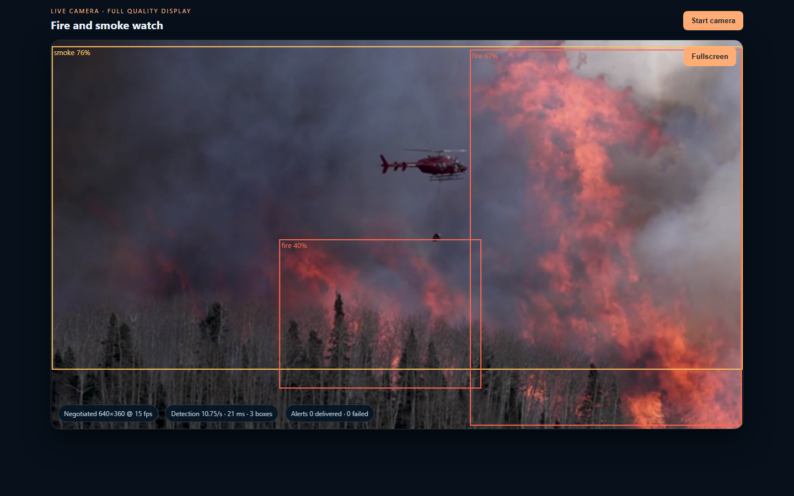
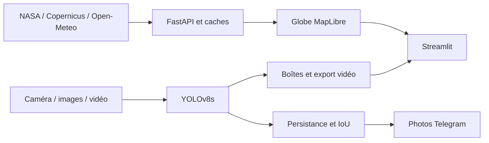

[English](README.md)

# MedFire Watch

[![CI][ci-badge]][ci]

[](LICENSE)

MedFire Watch : détection des feux de forêt et de la fumée avec YOLOv8, points chauds satellites NASA, carte de danger météo et alertes Telegram.

| Prédiction en direct | Du globe à la ville en 3D |
| :---: | :---: |
|  |  |

## Ce qu'il fait

- Explorer un globe MapLibre avec observations thermiques NASA, danger météo officiel et prévisions locales.
- Détecter le feu et la fumée par caméra et mettre en file des photos Telegram après détections persistantes.
- Analyser des images et lire les vidéos avec boîtes alignées, chronologie des détections et priorité de recherche.
- Consulter l'historique d'envoi et télécharger les vidéos annotées à leur résolution source.
- Gérer la détection Telegram à côté de Supprimer tout dans Alerts ; modifier ou réinitialiser le délai depuis Live camera.

## Démarrage rapide

[Guide complet : installation, clé NASA, Telegram et premier lancement](docs/GUIDE.md)

Python 3.11 est strictement requis (Python 3.12+ n'est pas supporté). Créez l'environnement virtuel, installez les dépendances et lancez les services via son interpréteur.

Windows PowerShell :

```powershell
py -3.11 -m venv .venv
.\.venv\Scripts\Activate.ps1
pip install --upgrade pip
pip install -r requirements.txt
python scripts/run_app.py
```

Linux/macOS :

```bash
python3.11 -m venv .venv
source .venv/bin/activate
pip install --upgrade pip
pip install -r requirements.txt
python scripts/run_app.py
```

Avant le lancement, copiez `.env.example` vers `.env` et renseignez votre clé FIRMS et le jeton du bot Telegram.
Suivez le [guide de configuration](docs/GUIDE.md) pour détecter votre conversation privée. Ouvrez
[localhost:8501](http://127.0.0.1:8501). L'inférence d'images et de vidéos fonctionne aussi sans ces identifiants.

Dans **Live camera**, enregistrez un délai de 0 à 1440 minutes (0 désactive l'attente), ou sélectionnez
**Reset current wait** pour autoriser la prochaine alerte admissible. Le délai reste enregistré après redémarrage ;
la réinitialisation conserve l'historique et n'envoie pas de photo à elle seule.

### Configuration

| Variable | Défaut | Rôle |
| --- | --- | --- |
| `FIRMS_MAP_KEY` | Aucun | Clé NASA FIRMS MAP_KEY pour les observations thermiques satellite sur 24 h |
| `TELEGRAM_BOT_TOKEN` | Aucun | Jeton de bot Telegram obtenu via BotFather |
| `TELEGRAM_CHAT_ID` | Aucun | Identifiant de chat Telegram destinataire des alertes |
| `MEDFIRE_API_TOKEN` | Aucun | Jeton d'API optionnel exigeant l'en-tête `X-MedFire-Token` sur les endpoints d'écriture |
| `MEDFIRE_ALLOWED_HOSTS` | Aucun | Hôtes supplémentaires autorisés dans l'en-tête `Host` au-delà de localhost |
| `MEDFIRE_ALLOWED_ORIGINS` | Aucun | Origines supplémentaires autorisées pour les requêtes de mutation inter-origines |
| `MEDFIRE_VIDEO_TTL_HOURS` | `24` | Durée de rétention (en heures) des vidéos traitées et des tuiles météo en cache |
| `MEDFIRE_MAX_VIDEO_JOBS` | `2` | Nombre maximal de traitements vidéo simultanés avant retour HTTP 429 |
| `MEDFIRE_INCLUDE_LOW_CONFIDENCE` | `0` | Définir à `1` pour inclure les points chauds satellite VIIRS de faible confiance |
| `MEDFIRE_SKIP_WARMUP` | `0` | Définir à `1` pour ignorer le préchauffage lourd du modèle au démarrage et en test |

## Résultats clés

| Mesure | Résultat |
| --- | --- |
| mAP50, test officiel D-Fire | **0,747**, 4 306 images |
| Précision / rappel | **0,740 / 0,681** |
| Analyse vidéo GPU, lots de 8 | **205,81 images/s**, NVIDIA RTX 4060 |
| Export annoté 1080p60 | **44,209 images/s**, 1 645 images en entrée et en sortie |

Sources : [métriques](docs/results/detection_final_metrics.json), [conditions de mesure](docs/VIDEO_BENCHMARK.md), [fiche modèle](docs/MODEL_CARD.md).

| Courbe Précision–Rappel | Matrice de Confusion |
| :---: | :---: |
|  |  |
| *Courbe précision–rappel sur le test officiel D-Fire* | *Matrice de confusion sur le test officiel D-Fire* |

## Interface

| Carte de Danger Incendie | Inspecteur d'Images |
| :---: | :---: |
|  |  |
| *Catégories de danger incendie Copernicus GWIS dans MapLibre GL* | *Inspection d'image avec boîtes de détection et scores de confiance* |

| Alerte Caméra en Direct |
| :---: |
|  |
| *Surveillance caméra en direct avec filtrage de persistance et IoU* |

Pour consulter l'intégralité des captures d'écran, du studio vidéo, des crédits cartographiques et de la preuve de livraison Telegram, voir les [Captures d'Interface](docs/SCREENSHOTS.md).

## Fonctionnement



L'[Architecture](docs/ARCHITECTURE.md) détaille la gestion du cache et les mécanismes de repli matériel. La documentation d'[Entraînement](docs/TRAINING.md) décrit la préparation des données et l'évaluation.

## Limites

- Les observations satellite peuvent être tardives, masquées par les nuages ou industrielles ; elles ne confirment pas un incendie.
- Le danger météo n'est pas une probabilité d'ignition ; le zoom n'affine pas la prévision et la mosaïque EOX est datée.
- La détection par caméra peut manquer un incendie ou générer de fausses alertes ; le taux d'alertes par heure de caméra reste non mesuré.
- Le matériel, le navigateur et le réseau influencent la latence et l'envoi ; l'export à fréquence variable est incomplet.
- Cette application de recherche aide l'investigation humaine et requiert une confirmation par les services d'urgence.

[Limites détaillées](docs/LIMITATIONS.md) et [protocole du modèle](docs/MODEL_CARD.md)

## Feuille de route

Surveillance multi-caméra autonome, évaluation du délai d'alerte et des faux positifs,
et durcissement supplémentaire du déploiement. Le jeton d'API optionnel est déjà implémenté ; consultez
les [limites du déploiement](docs/DEPLOYMENT.md) avant de l'activer pour les clients navigateur.

## Développement

Installez les dépendances de développement et exécutez la suite de vérifications :

```bash
pip install -r requirements-dev.txt
npm ci

# Contrôles de qualité (tous doivent réussir)
ruff check .
pytest -q
npm test
npm run format:check
python scripts/check_docs.py
```

Définissez `MEDFIRE_SKIP_WARMUP=1` pour exécuter les tests sans charger les poids du modèle en mémoire.
Consultez le [Guide de Contribution](CONTRIBUTING.md) et le [Journal des Modifications](CHANGELOG.md).

## Technologies et structure

Python 3.11, FastAPI, Streamlit, Ultralytics YOLOv8, PyTorch, OpenCV, FFmpeg,
MapLibre GL JS, NumPy, pandas, pytest et tests Node.js.

| Répertoire | Rôle |
| --- | --- |
| `api/`, `dashboard/` | API et interface navigateur |
| `medfire_watch/`, `alerts/` | Détection, cartographie et notifications Telegram |
| `models/detection/weights/` | Poids du modèle entraîné |
| `scripts/`, `configs/` | Lancement, mise à jour, entraînement et configuration |
| `tests/`, `docs/` | Tests, métriques et documentation |

## Crédits et licences

Le code est publié sous [Licence AGPL-3.0](LICENSE), copyright Jasser Zormati.
Les conditions des fournisseurs et des jeux de données s'appliquent séparément ; voir les [Mentions Légales](THIRD_PARTY_NOTICES.md) et les [Sources de Données](docs/DATA.md).

## Auteur

Jasser Zormati · [LinkedIn](https://linkedin.com/in/jasser-zormati) · [GitHub](https://github.com/jasser-z)

[ci-badge]: https://github.com/jasser-z/medfire-watch/actions/workflows/ci.yml/badge.svg
[ci]: https://github.com/jasser-z/medfire-watch/actions/workflows/ci.yml
