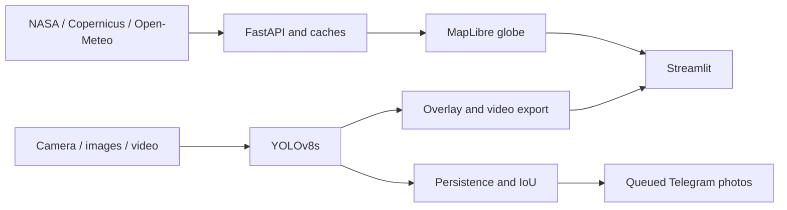

[Français](README.fr.md)

# MedFire Watch

Satellite and weather awareness with local camera, image and video fire/smoke detection.

[![CI][ci-badge]][ci]

[ci-badge]: https://github.com/jasser-z/medfire-watch/actions/workflows/ci.yml/badge.svg
[ci]: https://github.com/jasser-z/medfire-watch/actions/workflows/ci.yml

[](LICENSE)

| Live prediction | Earth zoom and 3D city |
| --- | --- |
|  |  |

## Key results

| Measurement | Result |
| --- | --- |
| D-Fire official test mAP50 | **0.747** on 4,306 images |
| Test precision / recall | **0.740 / 0.681** |
| GPU-scaled video analysis, batch 8 | **205.81 fps** on an NVIDIA RTX 4060 |
| 1080p60 annotated export | **44.209 processing fps**, 1,645 input and output frames |

Sources: [split metrics](docs/results/detection_final_metrics.json),
[benchmark conditions](docs/VIDEO_BENCHMARK.md), [model card](docs/MODEL_CARD.md).

## What it does

- Explore a MapLibre globe with NASA heat observations, official fire-weather danger and place forecasts.
- Detect fire/smoke from a browser camera and queue annotated Telegram photos after persistent detections.
- Inspect images and play original videos with aligned boxes, a detection timeline and seek prioritisation.
- Review photo delivery attempts and download full-resolution annotated video exports.

## Interface

| Fire danger | Image inspector |
| --- | --- |
|  |  |
|  |  |
|  |  |
|  | **Delivery proof** · 27 Oct 2026 · Smoke 73%. |

Satellite points show actual NASA observations. The Earth-to-city GIF above demonstrates 3D buildings.

The Alerts showcase includes the author's Telegram photo alert from 27 October 2026.

[Media sources and capture status](docs/media/CREDITS.md)

Maps: EOxCloudless by [EOX](https://eox.at/) (modified Copernicus Sentinel data 2025),
OpenFreeMap, © OpenMapTiles, © OpenStreetMap contributors. [Terms](THIRD_PARTY_NOTICES.md).

## Quick start

[Complete setup: installation, NASA key, Telegram and first run](docs/GUIDE.md)

Use Python 3.11. Create the environment, install, then launch using its interpreter.

Windows PowerShell:

```powershell
python -m venv .venv
.venv\Scripts\python.exe -m pip install -r requirements.txt
.venv\Scripts\python.exe scripts/run_app.py
```

Linux/macOS:

```sh
python3.11 -m venv .venv
.venv/bin/python -m pip install -r requirements.txt
.venv/bin/python scripts/run_app.py
```

Open [localhost:8501](http://127.0.0.1:8501). Copy `.env.example` to `.env` and supply your
own FIRMS key and Telegram credentials for those integrations. Image/video inference uses
the supplied checkpoint. [Guide](docs/GUIDE.md) covers setup and troubleshooting;
[deployment](docs/DEPLOYMENT.md) covers services and refresh.

## How it works



[Architecture](docs/ARCHITECTURE.md) explains caching, frame lookup and hardware fallbacks.

## Results


[Training and evaluation](docs/TRAINING.md) documents dataset preparation and held-out testing.

## Limits

- Satellite observations may be late, cloud-obscured or industrial heat; markers are not confirmed incidents.
- Weather danger is not ignition probability; zoom does not improve forecast resolution and EOX imagery is dated.
- Camera detections can miss fire or produce false alarms; held-out alerts per camera-hour are unmeasured.
- Hardware, browser and network conditions affect latency, compatibility and delivery; VFR export support is incomplete.
- This research application supports human investigation and requires emergency-service verification.

[Detailed limits](docs/LIMITATIONS.md) and [model protocol](docs/MODEL_CARD.md)

## Roadmap

Headless multi-camera monitoring; held-out false-alarm and time-to-alert evaluation;
optional API authentication and deployment hardening. These are planned capabilities.

## Stack and layout

Python 3.11, FastAPI, Streamlit, Ultralytics YOLOv8, PyTorch, OpenCV, FFmpeg,
MapLibre GL JS, NumPy, pandas, pytest and Node.js tests.

| Directory | Purpose |
| --- | --- |
| `api/`, `dashboard/` | API and browser interface |
| `medfire_watch/`, `alerts/` | Detection, map services and Telegram delivery |
| `models/detection/weights/` | Deployed checkpoint |
| `scripts/`, `configs/` | Launch, refresh, training and configuration |
| `tests/`, `docs/` | Checks, results and documentation |

## Credits and licenses

Code: [AGPL-3.0](LICENSE), copyright Jasser Zormati. Provider and dataset rights remain
separate; free EOX imagery and free Open-Meteo access have non-commercial conditions.
[Third-party notices](THIRD_PARTY_NOTICES.md) covers attribution, share-alike and unresolved
original-image permissions. See [data sources](docs/DATA.md).

## Author

Jasser Zormati · [LinkedIn](https://linkedin.com/in/jasser-zormati) · [GitHub](https://github.com/jasser-z)
