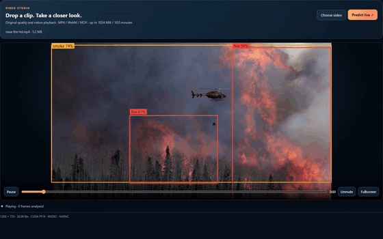
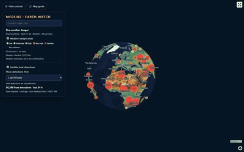
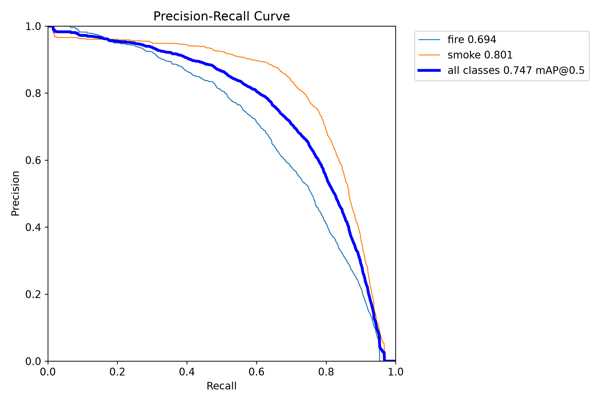
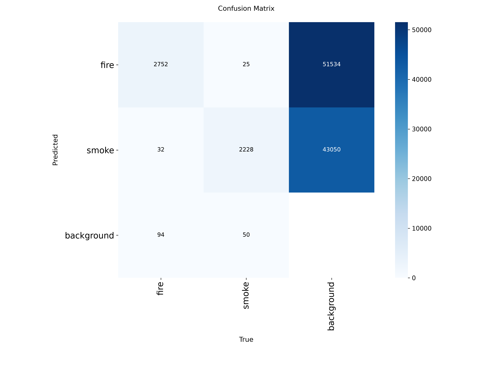
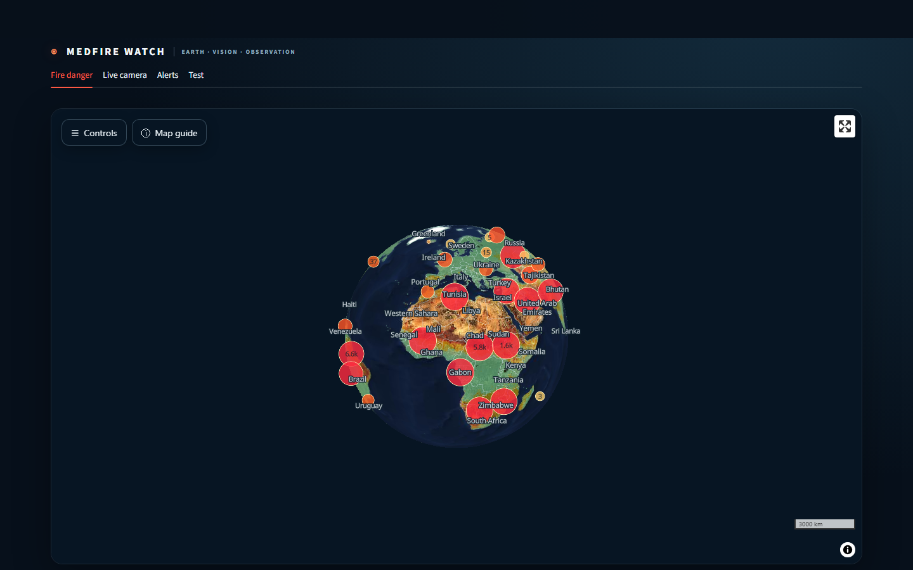
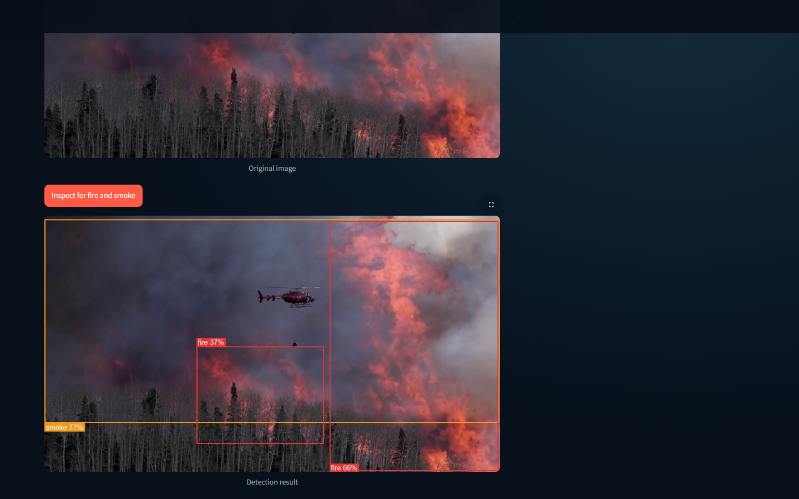
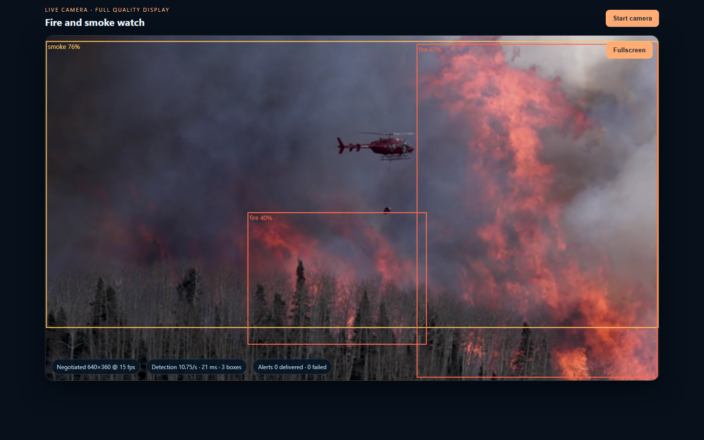
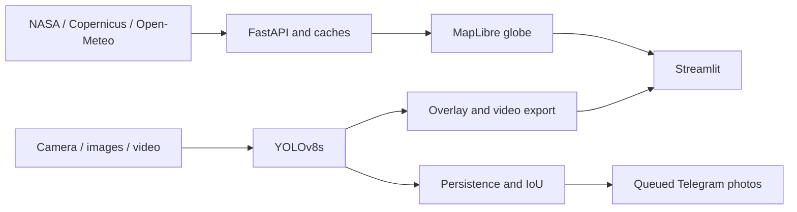

[Français](README.fr.md)

# MedFire Watch

[![CI][ci-badge]][ci]

[](LICENSE)

MedFire Watch: wildfire and smoke detection with YOLOv8, NASA satellite hotspots, a fire-weather danger map and Telegram alerts.

| Live prediction | Earth zoom and 3D city |
| :---: | :---: |
|  |  |

## What it does

- Explore a MapLibre globe with NASA heat observations, official fire-weather danger and place forecasts.
- Detect fire and smoke from a browser camera and queue annotated Telegram photos after persistent detections.
- Inspect images and play original videos with aligned boxes, a detection timeline and seek prioritisation.
- Review photo delivery attempts and download full-resolution annotated video exports.

## Quick start

[Complete setup: installation, NASA key, Telegram and first run](docs/GUIDE.md)

Python 3.11 is strictly required (Python 3.12+ is not supported). Create the environment, install requirements, and launch services using its interpreter.

Windows PowerShell:

```powershell
python -m venv .venv
.\.venv\Scripts\Activate.ps1
pip install --upgrade pip
pip install -r requirements.txt
python scripts/run_app.py
```

Linux/macOS:

```bash
python3.11 -m venv .venv
source .venv/bin/activate
pip install --upgrade pip
pip install -r requirements.txt
python scripts/run_app.py
```

Open [localhost:8501](http://127.0.0.1:8501). Copy `.env.example` to `.env` and supply your own FIRMS key and Telegram credentials for those integrations. Image and video inference works locally with zero extra configuration.

### Configuration

| Variable | Default | Purpose |
| --- | --- | --- |
| `FIRMS_MAP_KEY` | None | NASA FIRMS MAP_KEY for 24-hour satellite heat observations |
| `TELEGRAM_BOT_TOKEN` | None | Telegram bot token from BotFather |
| `TELEGRAM_CHAT_ID` | None | Telegram recipient chat ID for alert delivery |
| `MEDFIRE_API_TOKEN` | None | Optional API token requiring `X-MedFire-Token` on mutation endpoints |
| `MEDFIRE_ALLOWED_HOSTS` | None | Extra allowed `Host` headers beyond localhost and loopback |
| `MEDFIRE_ALLOWED_ORIGINS` | None | Extra allowed origins for cross-origin mutation requests |
| `MEDFIRE_VIDEO_TTL_HOURS` | `24` | Hours to retain completed video analysis results and weather cache tiles |
| `MEDFIRE_MAX_VIDEO_JOBS` | `2` | Maximum concurrent video processing jobs before returning HTTP 429 |
| `MEDFIRE_INCLUDE_LOW_CONFIDENCE` | `0` | Set to `1` to include low-confidence VIIRS satellite hotspots |
| `MEDFIRE_SKIP_WARMUP` | `0` | Set to `1` to bypass heavy YOLO inference warmup during launch/tests |

## Key results

| Measurement | Result |
| --- | --- |
| D-Fire official test mAP50 | **0.747** on 4,306 images |
| Test precision / recall | **0.740 / 0.681** |
| GPU-scaled video analysis, batch 8 | **205.81 fps** on an NVIDIA RTX 4060 |
| 1080p60 annotated export | **44.209 processing fps**, 1,645 input and output frames |

Sources: [split metrics](docs/results/detection_final_metrics.json), [benchmark conditions](docs/VIDEO_BENCHMARK.md), [model card](docs/MODEL_CARD.md).

| Precision–Recall Curve | Confusion Matrix |
| :---: | :---: |
|  |  |
| *Official D-Fire test precision–recall curve* | *Official D-Fire test confusion matrix* |

## Interface

| Fire Danger Map | Image Inspector |
| :---: | :---: |
|  |  |
| *Copernicus GWIS fire danger categories mapped in MapLibre GL* | *Single-frame inspection with bounding boxes and confidence scores* |

| Live Camera Alert |
| :---: |
|  |
| *Live browser camera monitoring with IoU persistence filtering* |

For the complete interface gallery, video studio views, map credits, and Telegram delivery proof, see [Interface Screenshots](docs/SCREENSHOTS.md).

## How it works



[Architecture](docs/ARCHITECTURE.md) explains caching, frame lookup and hardware fallbacks. [Training and evaluation](docs/TRAINING.md) documents dataset preparation and held-out testing.

## Limits

- Satellite observations may be late, cloud-obscured or industrial heat; markers are not confirmed incidents.
- Weather danger is not ignition probability; zoom does not improve forecast resolution and EOX imagery is dated.
- Camera detections can miss fire or produce false alarms; held-out alerts per camera-hour are unmeasured.
- Hardware, browser and network conditions affect latency, compatibility and delivery; VFR export support is incomplete.
- This research application supports human investigation and requires emergency-service verification.

[Detailed limits](docs/LIMITATIONS.md) and [model protocol](docs/MODEL_CARD.md)

## Roadmap

Headless multi-camera monitoring; held-out false-alarm and time-to-alert evaluation;
optional API authentication and deployment hardening. These are planned capabilities.

## Development

Install development dependencies and verify the test suite:

```bash
pip install -r requirements-dev.txt
npm ci

# Quality gates (all must pass)
ruff check .
pytest -q
npm test
npm run format:check
python scripts/check_docs.py
```

Set `MEDFIRE_SKIP_WARMUP=1` to run tests without loading model weights into memory.
See [Contributing Guide](CONTRIBUTING.md) for code style guidelines and [Changelog](CHANGELOG.md) for version history.

## Stack and layout

Python 3.11, FastAPI, Streamlit, Ultralytics YOLOv8, PyTorch, OpenCV, FFmpeg,
MapLibre GL JS, NumPy, pandas, pytest and Node.js tests.

| Directory | Purpose |
| --- | --- |
| `api/`, `dashboard/` | API and browser interface |
| `medfire_watch/`, `alerts/` | Detection, map services and Telegram delivery |
| `models/detection/weights/` | Deployed checkpoint |
| `scripts/`, `configs/` | Launch, refresh, training and configuration |
| `tests/`, `docs/` | Checks, results and documentation |

## Credits and licenses

Code is released under the [AGPL-3.0 License](LICENSE), copyright Jasser Zormati.
Provider and dataset terms apply separately; see [Third-Party Notices](THIRD_PARTY_NOTICES.md) and [Data Sources](docs/DATA.md).

## Author

Jasser Zormati · [LinkedIn](https://linkedin.com/in/jasser-zormati) · [GitHub](https://github.com/jasser-z)

[ci-badge]: https://github.com/jasser-z/medfire-watch/actions/workflows/ci.yml/badge.svg
[ci]: https://github.com/jasser-z/medfire-watch/actions/workflows/ci.yml
