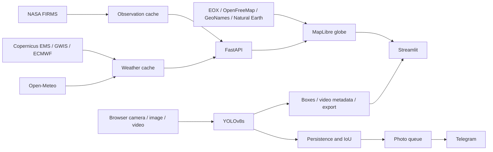

# Architecture

Streamlit presents Fire danger, Live camera, Alerts and Test. FastAPI serves map assets,
provider data, image inference, browser-camera monitoring and asynchronous video jobs.

The map consumes observations and provider forecasts independently of the detector.
The API starts a satellite worker that checks every minute; the observation cache expires
at ten minutes. Weather metadata, tiles and place forecasts use fifteen-minute caches.
The browser refreshes weather on opening, every fifteen minutes, at local midnight and
when the page becomes visible. Failed fetches preserve the last successful timestamp.

Native browser playback displays source video with a canvas overlay. Analysis decodes
small images, processes batches and publishes frame-indexed boxes. Seeking prioritises
the playhead; playback gates on contiguous analysed frames. A separate export reuses
analysis results at source resolution, preserves decoded frame count and copies compatible audio.
NVDEC/CUDA scaling and NVENC are used when available, with CPU fallbacks.

Live camera sends 960-pixel detector copies separately from native video rendering.
Photo alerts use elapsed-time persistence and overlapping boxes. The queued photo comes
from the same full-resolution source frame. See [model card](MODEL_CARD.md) for thresholds
and [limits](LIMITATIONS.md) for interpretation.
