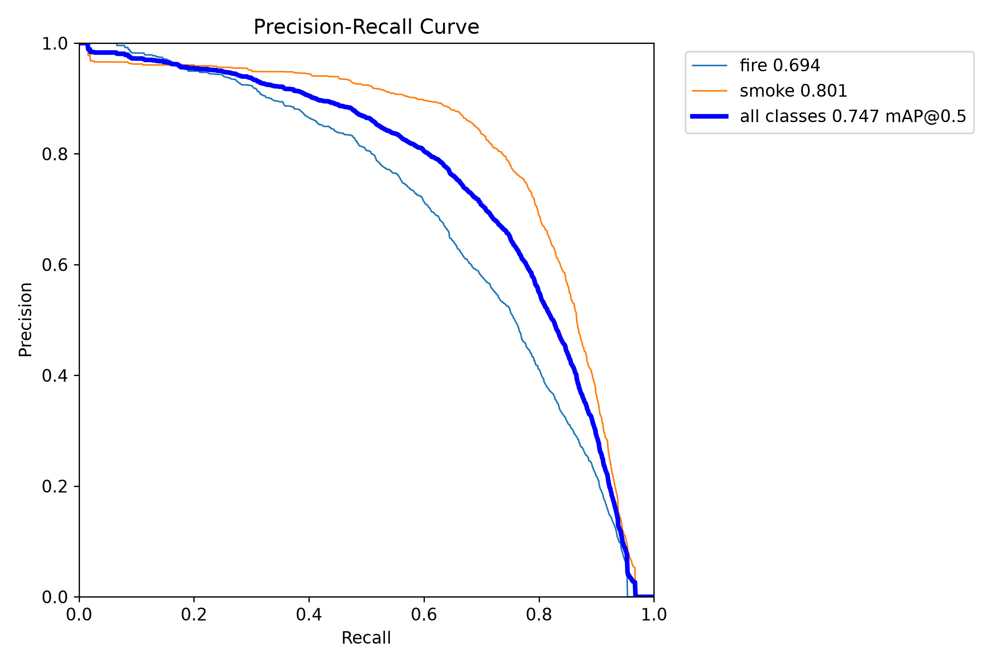

# Model card

## Detector

The deployed checkpoint is `models/detection/weights/best.pt`, a YOLOv8s fire/smoke detector.
Classes are fire (0) and smoke (1). Inference uses PyTorch, with FP16 on supported GPUs.
Runtime confidence is validation-selected at 0.2982982982982983 (about 0.298).

Camera photo alerts additionally require confidence ≥0.5, box area ≥1% of the frame,
one second of same-class persistence, and IoU ≥0.3. Short dropouts up to 0.35 seconds
preserve the track; the maximum matching gap is two seconds. Historical video metrics use
five consecutive detections instead; they do not measure camera photo-alert performance.

## Evaluation

| Split | Images | Instances | Precision | Recall | mAP50 | mAP50–95 |
| --- | --- | --- | --- | --- | --- | --- |
| D-Fire official test | 4,306 | 5,181 | 0.740 | 0.681 | 0.747 | 0.419 |
| D-Fire validation | — | — | 0.749148 | 0.669277 | 0.746682 | 0.433953 |
| Pyro-SDIS validation | 1,129 | 1,099 | 0.766161 | 0.670610 | 0.733260 | 0.398229 |

D-Fire official-test fire: 2,878 instances, P 0.696, R 0.613, AP50 0.694, AP50–95 0.356.
Smoke: 2,303 instances, P 0.783, R 0.749, AP50 0.801, AP50–95 0.483.
Full precision, validation per-class scores and provenance are in
[metrics](results/detection_final_metrics.json) and the [logged summary](results/dfire_official_test_logged_metrics.json).
The official test is evaluated once and never used for tuning. Pyro-SDIS has no fire
annotations, so its fire metrics are undefined.

The saved test confusion matrix has substantial unmatched/background detections and no
associated confidence/matching settings. Its counts cannot establish deployment-threshold
precision/recall. An explicit protocol and the original dataset are necessary to reproduce it.

A historical 12-second no-fire sample triggers two five-frame video events. This sample is
too short to estimate alerts per camera-hour. Held-out false-alarm rates and camera
time-to-alert are unmeasured. See [video evidence](VIDEO_BENCHMARK.md) and
[application limits](LIMITATIONS.md).

## Map

The map presents NASA observations, Copernicus/GWIS forecasts and Open-Meteo context.
It has no locally trained ignition model. Provider data is separate from detector training.
Dataset and model licensing is documented in [notices](../THIRD_PARTY_NOTICES.md).

## Runtime integrity

The engineering hardening validates finite model outputs, drops invalid/inverted boxes and clips
coordinates to the original image bounds. Images respect EXIF orientation. Inference remains serialized
on the shared model. The supplied weights and recorded evaluation metrics were not modified or retrained.
The patched CPU dependency pair is pinned in the requirements; CUDA migration is separately required.
Only load trusted checkpoints. Software regression tests do not constitute a new detector evaluation.
