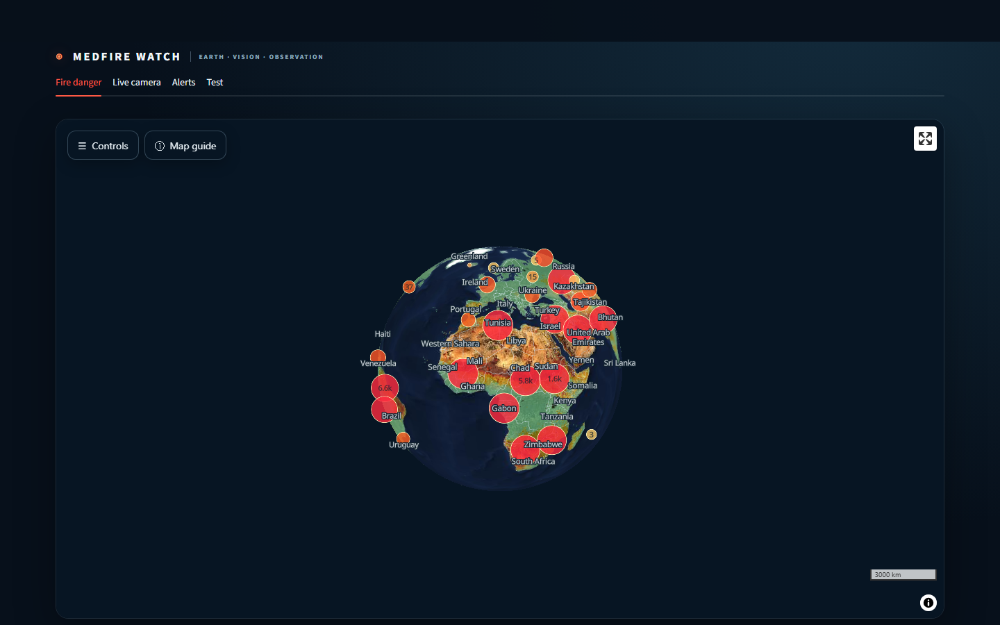
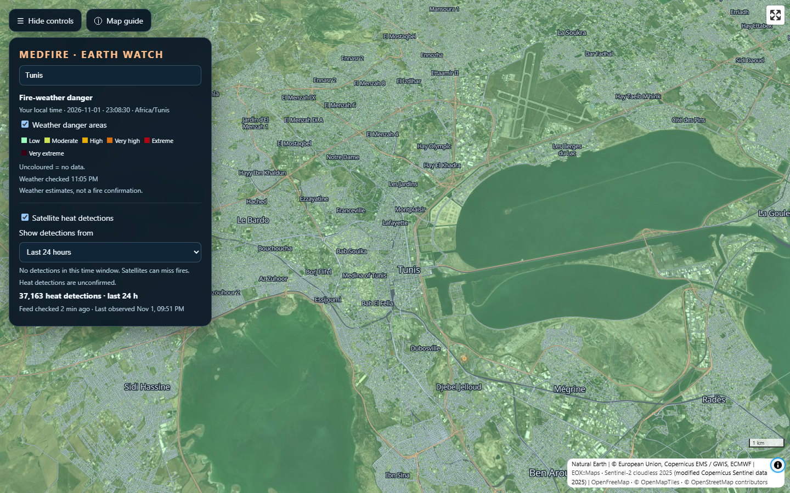
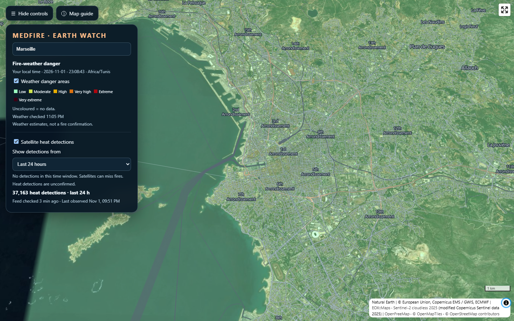
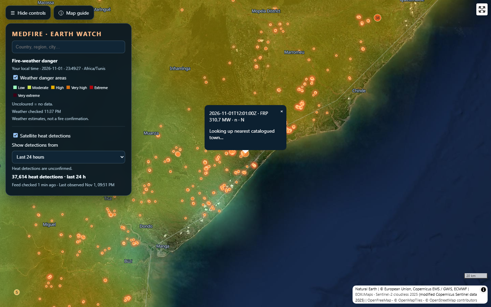
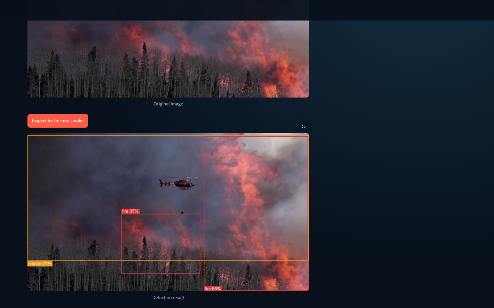
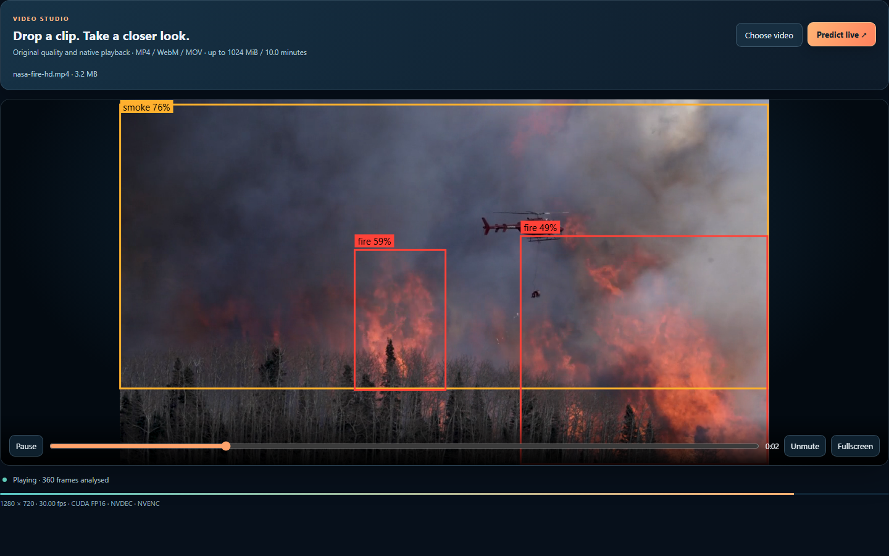
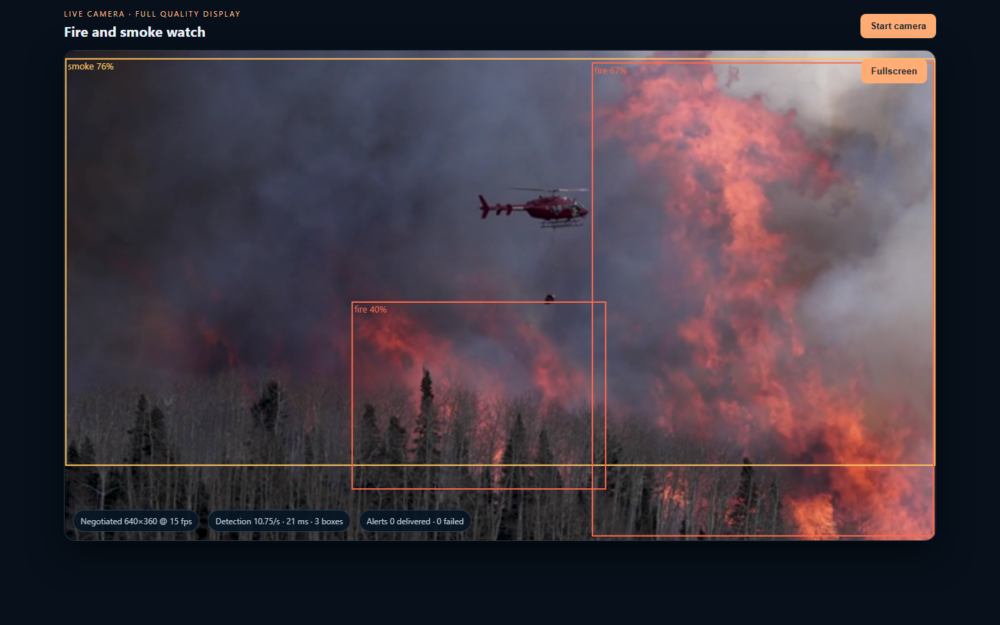
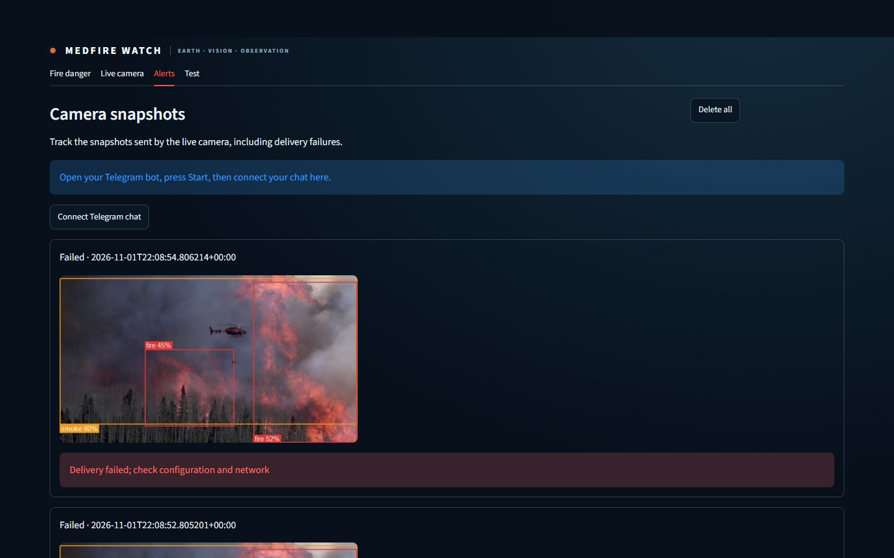
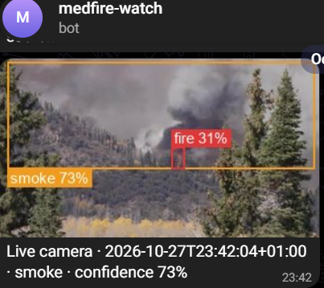
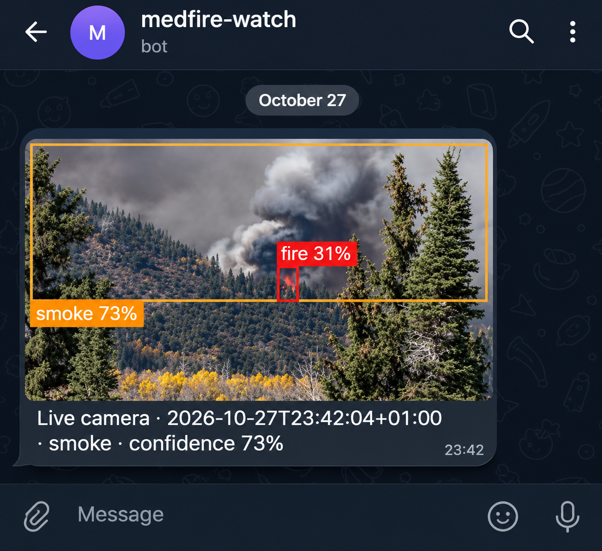

# MedFire Watch Interface Screenshots

This gallery showcases all interface views, satellite layers, video workflows, and alert notifications.

## Fire Weather & Danger Mapping

| Regional Fire Danger Classification | Populated Place Inspection (Tunis) |
| :---: | :---: |
|  |  |
| *Copernicus GWIS fire danger categories mapped in MapLibre GL* | *Local weather metrics and danger category for selected coordinates* |

| Regional 3D Urban View (Marseille) | NASA VIIRS Satellite Heat Detections |
| :---: | :---: |
|  |  |
| *3D building extrusions and EOX cloudless imagery* | *NASA FIRMS VIIRS active thermal hotspots within the last 24 hours* |

Satellite points represent actual NASA observations. The Earth-to-city animations demonstrate 3D building extrusions.

Maps: EOxCloudless by [EOX](https://eox.at/) (modified Copernicus Sentinel data 2025), OpenFreeMap, © OpenMapTiles, © OpenStreetMap contributors. See [Third-Party Notices](../THIRD_PARTY_NOTICES.md).

---

## Computer Vision & Video Studio

| Still Image Detection Inspector | Video Studio Playback & Timeline |
| :---: | :---: |
|  |  |
| *Single-frame inspection with class labels and confidence metrics* | *Video player with synchronized detection timeline and seek controls* |

| Live Web Camera Stream Monitoring |
| :---: |
|  |
| *Live browser camera monitoring with IoU persistence filtering* |

---

## Telegram Alerts & Delivery Verification

| Dispatch History Dashboard | Telegram Message Notification |
| :---: | :---: |
|  |  |
| *Dispatch attempt history and snapshot management* | *Mobile Telegram notification received from the alert bot* |

### Confirmed Telegram Delivery Proof

*The Alerts showcase includes the author's verified Telegram photo alert from 27 October 2026 (Smoke 73%).*

---

For media licenses and capture details, see [Media Credits](media/CREDITS.md).

